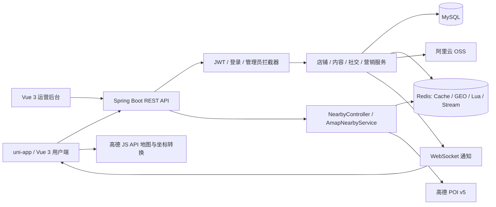

<div align="center">

# 校邻 CampusLife

**面向校园的生活分享与周边发现平台**

Spring Boot + Redis + Vue 3 / uni-app，覆盖真实周边地点、站内店铺、探店笔记、社交消息、优惠券和运营管理。


[快速开始](#快速开始) · [技术亮点](#技术亮点) · [周边模块说明](docs/nearby-places.md) · [简历项目描述](docs/resume-project.md)

</div>

## 项目介绍

CampusLife 将校园内容社区与本地生活场景结合：用户可以查找真实周边商家、浏览店铺和优惠券、发布关联店铺的笔记、参与评论与关注互动；运营人员通过独立管理后台维护用户、商户、内容和营销数据。

项目采用前后端分离架构，由 **Spring Boot 后端、uni-app 用户端和 Vue 管理后台**组成。H5 默认进入高德真实地点发现页，同时保留站内店铺的独立业务链路。

## 核心功能

| 模块 | 功能 |
| --- | --- |
| 真实周边地点 | 浏览器定位、地图选区、分类/半径/关键词筛选、商家图片与评分、距离展示、分页、地图列表联动、地址复制 |
| 站内店铺 | 分类和搜索、Redis GEO 附近查询、店铺详情、关联笔记与优惠券 |
| 内容社区 | 图文笔记、店铺关联、评分、点赞、收藏、评论与回复 |
| 关注与消息 | 关注关系、共同关注、滚动 Feed、WebSocket 消息通知、未读状态 |
| 营销与成长 | 优惠券、秒杀、订单流转、积分签到与兑换、勋章体系 |
| 运营后台 | 数据看板、用户与商户管理、笔记和评论管理、优惠券及订单管理 |

## 技术亮点

### 1. 真实周边发现与数据边界

- 使用 Spring `RestClient` 封装高德 v5 周边搜索，复用项目 `Result` 返回协议与前端请求工具。
- 一次查询通过 `show_fields=business,photos` 获取商业评分与图片，避免为列表逐条调用详情接口。
- 将高德 POI 与内部 `Shop` 分开建模，保留内部店铺 ID 在笔记、优惠券和详情中的业务关联。
- 通过独立页面、地图组件、地点卡片与查询适配层接入现有项目，复用原有导航和视觉体系。

### 2. 明确的定位与查询状态管理

- 定位采用 **浏览器原生 WGS84 → 高德官方转换 → GCJ-02 地图及查询中心**的单一链路。
- 蓝点和商家标记采用独立样式与层级，卡片、地图标记及选中状态同步更新。
- 使用查询快照与递增版本号处理请求竞态，过滤迟到响应；刷新失败保留已有结果，分页失败重试原页。
- 按 POI ID 去重、成功后推进页码，地图拖动由用户确认后查询；定位回调在离页或手动选区后失效。

### 3. 第三方接口治理

- 经纬度、分类、半径、关键词及页码在后端校验，统一清洗坐标、距离、评分和图片字段。
- Redis Lua 原子计数与过期实现 IP 限流，默认 **30 次 / 60 秒**，支持配置阈值与可信代理。
- 上游连接/读取超时分别为 **2 秒 / 5 秒**；前端独立适配层设置 **10 秒**等待上限。
- Web 服务 Key 保留在后端，JS 安全密钥由固定路径代理注入，提供环境模板和 Nginx 配置示例。

### 4. Redis 在业务场景中的应用

| 场景 | 实现 |
| --- | --- |
| 店铺缓存 | 店铺详情采用空值缓存防穿透；`CacheClient` 另封装互斥重建和逻辑过期策略 |
| 地理查询 | Redis GEO 支持站内附近店铺检索 |
| 优惠券秒杀 | Lua 原子校验库存和重复下单，结合 Redis Stream 消费、Redisson 锁与数据库订单处理 |
| 社交互动 | Set 管理点赞关系，ZSet 支持点赞排序与关注 Feed 滚动分页 |
| 登录状态 | JWT 鉴权、Redis Token 黑名单与 ThreadLocal 用户上下文 |
| 实时通知 | Spring WebSocket 推送与数据库通知记录、未读状态管理 |

## 系统架构



## 技术栈

| 层次 | 技术 |
| --- | --- |
| 后端 | Java 17、Spring Boot 3.5.16、MyBatis-Plus 3.5.17、JJWT |
| 数据与缓存 | MySQL 8、Redis、Lettuce、Redisson |
| 用户端 | Vue 3、uni-app、Vite、Sass |
| 管理端 | Vue 3、Vue Router、Pinia、Element Plus、ECharts |
| 外部能力 | 高德 JS API 2.0 / Web 服务 v5、阿里云 OSS |
| 验证 | JUnit 5、MockMvc、MockRestServiceServer、Node Test Runner、Playwright |

## 代码导览

```text
CampusLife/
├── src/main/java/com/cn/
│   ├── controller/        # 账号、店铺、内容、社交、营销及管理接口
│   ├── service/           # 业务逻辑与事务
│   ├── nearby/            # 高德查询封装、参数校验、限流与响应模型
│   ├── mapper/            # MyBatis-Plus 数据访问
│   ├── utils/             # 缓存、鉴权、ID 生成等公共能力
│   └── ws/                # WebSocket 通知
├── src/main/resources/    # 配置示例、Lua 脚本、Mapper XML
├── src/test/java/         # 后端测试
├── uni-app-project/
│   ├── pages/             # 用户页面及独立真实地点页
│   ├── components/        # 地图、地点卡片和原业务组件
│   ├── api/               # 请求适配层
│   └── tests/             # 查询状态、坐标与浏览器验证
├── admin-panel/           # 运营管理后台
├── sql/                   # 数据库初始化脚本
├── screenshots/           # 项目界面
└── docs/                  # 模块说明、部署代理及简历材料
```

关键实现：[高德服务](src/main/java/com/cn/nearby/AmapNearbyService.java) · [IP 限流](src/main/java/com/cn/nearby/NearbyRateLimiter.java) · [查询状态](uni-app-project/utils/nearby-state.js) · [定位封装](uni-app-project/utils/nearby-location.js) · [地图组件](uni-app-project/components/nearby-map/nearby-map.vue)

## 快速开始

### 环境

JDK 17+、Maven、MySQL 8、Redis 5+、Node.js 20+。用户端也可使用 HBuilderX 打开运行。

### 1. 数据与后端

导入初始化数据，并首次创建订单消费者组：

```bash
mysql -uroot -p < sql/city-reviews.sql
redis-cli XGROUP CREATE stream.orders g1 '$' MKSTREAM
```

在项目根目录的 PowerShell 中准备配置：

```powershell
if (!(Test-Path src/main/resources/application.yaml)) {
    Copy-Item src/main/resources/application-example.yaml src/main/resources/application.yaml
}
if (!(Test-Path .env.local)) { Copy-Item .env.example .env.local }
if (!(Test-Path uni-app-project/.env.local)) {
    Copy-Item uni-app-project/.env.example uni-app-project/.env.local
}
```

填写数据库、Redis、JWT、OSS 等项目配置，以及高德 Web 服务 Key、JS API Key 和 JS 安全密钥。根目录环境文件通过以下命令加载到后端进程：

```powershell
Get-Content .env.local | ForEach-Object {
    if ($_ -match '^\s*(AMAP_WEB_KEY|NEARBY_RATE_LIMIT|NEARBY_TRUSTED_PROXIES)=(.*)$') {
        [Environment]::SetEnvironmentVariable($Matches[1], $Matches[2].Trim(), 'Process')
    }
}
mvn spring-boot:run
```

后端默认端口为 `8081`。完整字段与地图安全代理配置见 [周边模块运行说明](docs/nearby-places.md)。

### 2. 用户端 H5

```bash
cd uni-app-project
npm ci
npm run dev:h5
```

访问 `http://127.0.0.1:5173/`。首页“周边好店”及底部“周边”打开真实地点页，顶部“站内店铺”切回内部商户。站内业务接口地址由 `utils/constants.js` 配置；新增地点查询通过同源 `/api` 代理访问后端。

### 3. 管理后台

```bash
cd admin-panel
npm ci
npm run dev -- --port 5174
```

访问 `http://localhost:5174/`。

### 4. HTTPS 部署

H5 页面与新增 API 使用同源 HTTPS，地图 SDK 安全代理在服务端注入密钥。参考 [Nginx 配置模板](docs/nearby-nginx.conf.template)，合入站点配置后执行 `nginx -t` 验证。

真实 `.env.local`、后端运行配置、证书及测试产物保留在本地；仓库提供可填写的配置示例。

## 测试与构建

新增周边模块提供 **8 项后端测试、11 项前端状态与定位测试**，覆盖参数和响应清洗、上游异常、限流、请求竞态、分页去重以及原生坐标转换。

```powershell
# 根目录：后端测试
mvn "-Dtest=com.cn.nearby.NearbyTest" test

# 用户端目录：状态与定位测试
cd uni-app-project
node --test tests/nearby-state.test.mjs tests/nearby-location.test.mjs

# H5 构建
$env:UNI_INPUT_DIR = (Get-Location).Path
node node_modules/@dcloudio/vite-plugin-uni/bin/uni.js build -p h5
```

另提供独立 Redis 集成测试与 Playwright 交互脚本，运行方式见 [模块说明](docs/nearby-places.md)。

## 项目展示与简历

[简历项目描述与面试讲解提纲](docs/resume-project.md)提供项目概述、技术职责、源码入口和两分钟演示顺序，可结合目标岗位选取内容。

## License

[MIT](LICENSE)
